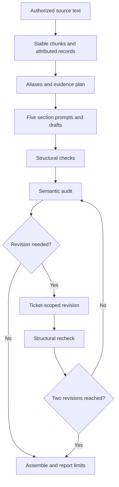

# LENS reusable workflow

A model-independent skill for **Legal Evidence Navigation Summarization**: preserve who said what, plan evidence before writing, link statements to their source, and revise through explicit audit tickets.

The reusable contribution is the workflow. It does not depend on continued access to the model endpoints used in the associated research. Practitioners can assign available models to the roles, while retaining the evidence boundaries, artifact contracts, and stopping rules.

## What is included

- [`lens-workflow/SKILL.md`](lens-workflow/SKILL.md): the entry point for an assistant with file-reading/writing capabilities.
- Role instructions, source preparation, five-section generation, audit and revision, and optional evaluation guidance.
- A portable artifact contract and a small standard-library Python validator.
- One **entirely fictional, hand-authored** example for checking the artifact format. It is not a model output, real judgment, clinical account, or benchmark.

This is an adaptation of the LENS project workflow for reuse, **not a frozen reproduction package for the paper**. The original provider-specific orchestration extensions, full experimental corpus, expert-written reference collection, historical model endpoints, and reported performance results are not distributed here. Model substitutions must be logged and evaluated; the paper's performance numbers do not transfer to a new configuration.

## Use the skill

Copy the `lens-workflow` folder to the skill directory supported by your assistant, or open `lens-workflow/SKILL.md` directly and supply it as workflow instructions. For Codex, the conventional user skill directory is `~/.codex/skills/`; for other hosts, follow their own installation documentation.

Example request:

> Use the lens-workflow skill to process my authorized judgment text. Prepare source chunks and structured records, then plan and write a five-section Traditional Chinese summary with source citations. Use the models available in this environment, record the role assignments, and report any validation that could not be executed.

The skill itself does not install an inference server, obtain credentials, or call a paid model. You provide authorized input text and a host capable of running the requested roles. Roles may be separate agents or separate contexts of one model; retain the same stage dependencies in either arrangement.

## Check the example

Python 3.10 or later is sufficient; no packages or API keys are required.

```sh
python lens-workflow/scripts/validate_artifacts.py lens-workflow/assets/synthetic-case
```

Expected result: `PASS: structural checks only; semantic source support has not been verified.`

The validator checks artifact structure, section coverage, source-ID references, allocation bounds, and revision limits. It does **not** establish factual accuracy, legal correctness, anonymity, semantic entailment, or suitability for professional decisions. The semantic audit and human review remain separate steps.

## Workflow at a glance



Repair structural failures before proceeding to semantic audit. The diagram shows the default bounded loop; preserve unresolved issues when its budget is exhausted.

1. Preserve the original source and create stable chunks.
2. Extract attributed case records and verify their source spans.
3. Prepare aliases, a source inventory, and a case digest.
4. Allocate evidence and writing budgets across five sections.
5. Build section-specific prompts and generate cited drafts.
6. Run structural checks and an independent semantic audit.
7. Apply ticket-scoped revisions, with at most two revision rounds.
8. Assemble the summary and report unresolved issues and validation limits.

The five sections are Facts and prosecution allegations, Defense, Expert opinions, Disposition, and Judicial reasoning. An expert opinion must not silently become a court finding; a defense assertion must not become an established event.

## Models and reproducibility

See [model adaptation](lens-workflow/references/model-adaptation.md). Record actual provider/model identifiers, execution dates, settings, and unavailable endpoints. Never silently replace a failed model while labelling the run as the original configuration. The maintainers do not assert that any particular historical endpoint is currently available.

For evaluation, distinguish expert-reference coverage, judgment-source support, rubric quality, and practitioner preference. These are different measurements, not interchangeable evidence of correctness. See [evaluation](lens-workflow/references/evaluation.md).

## Research context and release scope

This skill accompanies the research manuscript **LENS: An Inspectable Framework for Source-Grounded Summarization of Criminal Medical Negligence Judgments**. Publication status and a permanent article identifier are not asserted by this repository. See [release scope](docs/release-scope.md) for the adaptation decisions and exclusions.

No real case records, expert reference summaries, participant ratings, API credentials, or private machine paths are included. Use only materials you are authorized to process and share. This repository currently has no open-source license grant; the rights holders can add the intended license separately.
